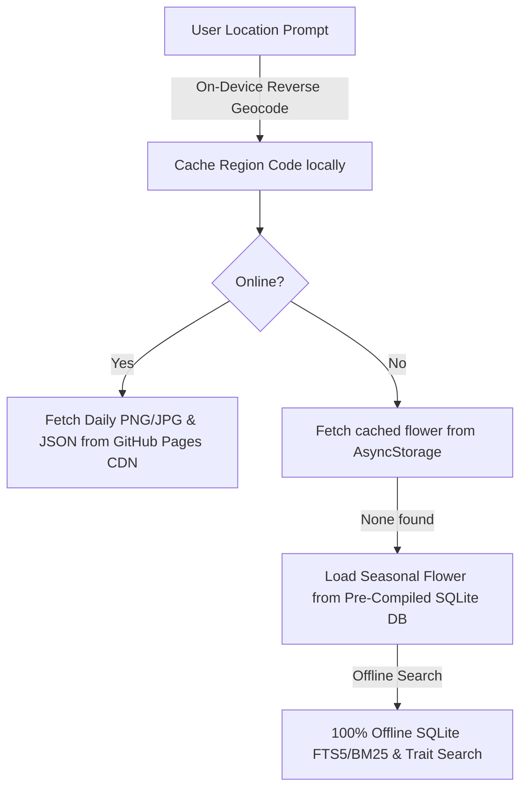

# Specimen Sandbox

A daily ritual app: every morning, a fresh, localized, AI-generated image of a native flower is delivered to your device, matching the season and current geographic region (US states, Canadian provinces, and international region codes).

---

## 🏛️ Core Architecture & Flow

The app operates on a hybrid client-server model optimized for privacy, performance, and offline-first usage:



### 1. Privacy-First Location Resolution
On first launch, the app requests location permission **once** to resolve the user's location via standard geocoding to a coarse region code (e.g., `CA`, `CA-ON`, `MX-MEX`, `RU-MOW`, or `default`). This code is cached locally in `AsyncStorage`; coordinates never leave the device.

### 2. Static CDN Automation Pipeline
Every night at **04:00 PT**, a GitHub Actions cron workflow executes:
* Selects one in-season native species per region across 112 regions from [lib/data/species.json](lib/data/species.json).
* Directs Gemini (`gemini-3.1-flash-image` / `gemini-3.1-flash-lite-image`) to generate a high-fidelity botanical illustration of the species.
* Publishes daily PNG imagery (days 0–7) and compressed JPG archive imagery (day 8+) alongside metadata JSON (`imageExt`).
* Commits the output directly to the GitHub Pages directory structure: `/docs/daily/{region}/{YYYY-MM-DD}.{png,jpg,json}`.

### 3. 100% Offline Botanical Search & Species Database
To support a completely offline experience with zero client-side Gemini API keys or outbound search calls, the app includes a pre-compiled SQLite database ([assets/species.db](assets/species.db)) covering **396 species across 112 regions**:
* **Build-time compilation:** Generated using [scripts/compile_species_db.mjs](scripts/compile_species_db.mjs) using the Gemini Embeddings API (`gemini-embedding-001`) to store `3072`-dimension vectors (`float[3072]`) alongside FTS5/botanical metadata.
* **Offline Search Engine:** Reads the bundled database using `expo-sqlite` and executes **100% offline** on-device via SQLite FTS5/BM25 full-text ranking and tokenized/prefix/vibe matching (with an in-memory fallback over [lib/data/species.json](lib/data/species.json) on Web).

---

## 📂 Repository Layout

```
├── app/
│   ├── _layout.tsx                  # Navigation controller stack & RevenueCat init
│   ├── index.tsx                    # Home Screen: Daily showcase flip card, Travel Mode & Search
│   ├── flower-detail.tsx            # Full-screen detail & botanical specimen view
│   └── +not-found.tsx
├── lib/                             # Core Application Logic Providers
│   ├── data/
│   │   ├── defaults.ts              # Bundled California Poppy daylight variants
│   │   └── species.json             # Curated 396-species catalog across 112 regions
│   ├── dailyFlower.ts               # CDN integration, PNG/JPG resolution & AsyncStorage cache
│   ├── premium.ts                   # Daily free search quota & entitlement checks
│   ├── purchases.ts                 # RevenueCat initialization, offerings & listeners
│   ├── region.ts                    # One-shot geocoding, caching, and region mapping
│   └── speciesDb.ts                 # SQLite sandbox, versioning & offline search service
├── shared/                          # Shared UI Components, Constants, Hooks & Styles
│   ├── components/
│   │   ├── IridescentOverlay.tsx
│   │   ├── ModernFlipCard.tsx
│   │   └── PremiumModal.tsx
│   ├── constants/brand.ts
│   ├── hooks/
│   └── styles/
├── assets/
│   ├── defaults/                    # Bundled California Poppy daylight PNGs
│   ├── icons/                       # App icon assets
│   ├── locales/                     # Localization metadata
│   ├── species.db                   # Pre-compiled SQLite DB (396 species, float[3072] embeddings)
│   └── images/favicon.png           # Web environment asset
├── scripts/                         # Developer & Pipeline Automation (ES Modules)
│   ├── agent-squash-popups.mjs      # Simulator popup dismissal helper for automation
│   ├── capture_screenshots.mjs      # App Store screenshot capture script
│   ├── capture_screenshots_auto.mjs # Automated Maestro-driven screenshot capture
│   ├── compile_species_db.mjs       # Build-time SQLite generator & 3072-dim embedder
│   ├── db-smoke.mjs                 # SQLite schema & embedding dimension smoke test
│   ├── delete-draft-submission.mjs  # App Store Connect draft submission cleanup
│   ├── generate-daily.mjs           # Daily automated content compiler and publisher
│   ├── manage-subscriptions.mjs     # App Store Connect subscription management
│   ├── remove-version-from-submission.mjs # App Store Connect submission helper
│   └── verify_screenshots.mjs       # Screenshot alpha-stripping and validation QC
├── tests/
│   ├── unit/                        # Node 22 unit tests (`pnpm test:unit`)
│   └── e2e/                         # Requirement-driven behavioral verification tests (`pnpm test:e2e`; `pnpm test` runs both)
├── .eas/workflows/
│   └── update-on-push.yml           # EAS Update CI workflow
├── .github/workflows/
│   ├── ci.yml                       # Lint, typecheck & unit test CI
│   └── generate-daily.yml           # GitHub Actions cron (0 11 * * * UTC)
├── .maestro/                        # Maestro mobile E2E flows
├── docs/                            # Static GitHub Pages assets (privacy page, web index, CDN directory)
└── meta/                            # Developer onboarding, compliance guides, and app store specs
```

---

## 🚀 Getting Started

### Prerequisites

The project is built on **Expo SDK 56** and **React Native 0.85.3**. Package management is governed strictly by **pnpm**.

```bash
# Install dependencies
pnpm install

# Run static checks, unit tests, and E2E verification tests
pnpm typecheck
pnpm lint
pnpm db:smoke
pnpm test        # runs unit + E2E tests (`pnpm test:unit` / `pnpm test:e2e`)

# Start the development server
pnpm exec expo start
```

*Note: Expo SDK 56 and above are not compatible with Expo Go.* To run the app on a device or simulator, you must compile a custom development build using the commands below.

### Native Pre-Release Builds
To verify native behaviors (such as background loading or App Store compliance) compile a local development build:

```bash
# Build for iOS Simulator (does not require Apple signing credentials)
pnpm exec eas build --profile development-simulator --platform ios --local

# Build for physical iOS device (configured via your Apple Team credentials)
pnpm exec eas build --profile development --platform ios --local

# Build for Android
pnpm exec eas build --profile development --platform android --local
```

---

## 🛠️ Operations & Cron Management

### 1. Initial Setup Checklist

> [!IMPORTANT]
> To configure the automated Daily Content Generator, the following repository configurations are required:

1. **Actions Secret:** Add a secret named `GEMINI_API_KEY` under **Settings** → **Secrets and variables** → **Actions** with a valid key from Google AI Studio.
2. **GitHub Pages Deployment:** Go to **Settings** → **Pages**, configure source to **Deploy from a branch**, set branch to `main`, and directory to `/docs`.
3. **Dry-Run Validation:** Navigate to **Actions** → **Generate Daily Flowers** → click **Run workflow**, set `dry_run` to `true`, and trigger the run. Verify that it executes successfully.

### 2. Manual Workflow Controls

Run workflows manually from **Actions** → **Generate Daily Flowers** using these parameters:

| Input Parameter | Default Value | Description / Use Case |
| :--- | :--- | :--- |
| `date` | Today (UTC) | Force generate content for a specific date (Format: `YYYY-MM-DD`). |
| `states` | *all* | Restrict execution to selected regions (e.g. `CA,NY,TX,MX-JAL`). |
| `missing_only` | `false` | Conservative backfill: skips regions that already have partial files. |
| `dry_run` | `false` | Executes the generation process without writing changes to git. |

### 3. Content Backfill Procedures

If the daily workflow experiences partial failures (due to API rate limits or network hiccups), you can perform a targeted backfill:

```bash
# Run local backfill for a specific date
GEMINI_API_KEY=your_key_here node scripts/generate-daily.mjs --date 2026-04-25 --missing-only
```

The script will log progress and skip pre-existing regional assets, and output commands to resume where it left off.

---

## 📖 Project Documentation Index

Refer to the documents under [meta/](meta/) for platform administration and compliance:

* **[DEVELOPMENT.md](meta/DEVELOPMENT.md)**: Deep dive into Expo SDK 56 development, local builders, simulator setups, and common troubleshooting steps.
* **[DEPLOYMENT.md](meta/DEPLOYMENT.md)**: Release checklists and guide for TestFlight, Play Store internal tracks, and EAS update releases.
* **[SUBMISSION.md](meta/SUBMISSION.md)**: Reference sheet for metadata configuration, IAP status, content rating, and legal questionnaires.
* **[SUBMISSION_CHECKLIST.md](meta/SUBMISSION_CHECKLIST.md)**: Actionable checklist tracking remaining pre-submission release blockers.
* **[ERROR_STATES.md](meta/ERROR_STATES.md)**: Offline status behaviors, CDN error layouts, and manual smoke testing.
* **[PRIVACY.md](meta/PRIVACY.md)**: Official Privacy Policy text (automatically served publicly at `docs/privacy.html`).
