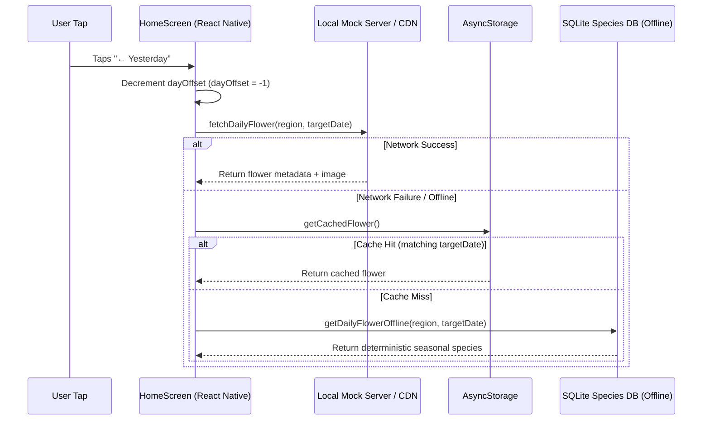
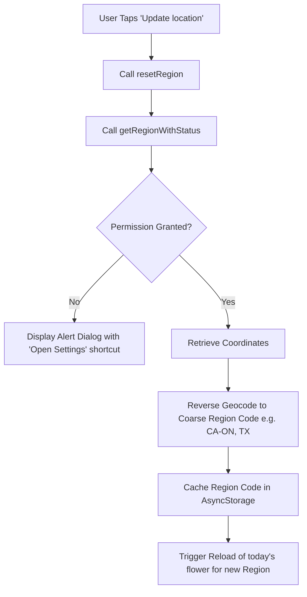
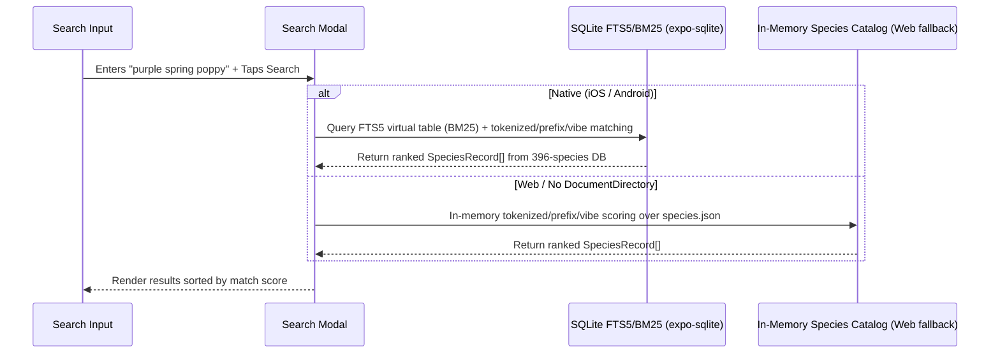

# Specimen Sandbox: UX Features & Architecture

This document describes the design, implementation, and UX flow for the core interactive features of the **Specimen Sandbox** application: **Yesterday's Flower**, **Update Location**, **Offline Botanical Search**, and **Travel Mode**.

---

## 1. Yesterday's Flower UX

### User Flow
* **Access**: The user taps the `← Yesterday` button in the navigation bar at the bottom-left of the screen.
* **Navigation**: Shifting backward increases a day offset count (`dayOffset` state in `HomeScreen`), up to a hard limit of `-6` days ago (1 week total).
* **Return**: Once the user is viewing a historical date, the navigation bar displays a `Today →` button at the bottom-right, allowing them to quickly return to the current day.

### Architectural Flow

### Key Considerations
* **Offline Fallbacks**: If the user navigation goes offline, the app preserves access by querying the deterministic index in the SQLite database, ensuring a premium "always works" user experience.

---

## 2. Update Location UX

### User Flow
* **Access**: Available as a text link in the bottom-right of the navigation bar when viewing **Today** (and when no manual region override is active).
* **Location Request**: Tapping it resets the resolved location cache and triggers a one-shot device GPS lookup.
* **Permissions handling**:
  * If the user accepts, the location is geocoded to a region code, and the daily flower for that region is loaded.
  * If the user denies or has previously denied location permission, a system alert modal is presented detailing why location is used (privacy-first region matching) with a direct shortcut button to **Open iOS System Settings**.

### Architectural Flow

---

## 3. Offline Botanical Search UX

### User Flow
* **Access**: The user taps the `🔍 SEARCH` button in the top-right corner of the top bar row.
* **Search Input**: Opens a modal overlay with a text input. Users can search by common name, Latin name, region, season, or botanical traits (e.g. *"purple spring poppy"*, *"desert cactus"*, *"yellow autumn bloom"*).
* **Query Execution**: Executes **100% offline on-device** with zero outbound network requests or client-side API keys.
* **Results**: Shows matching species ranked by relevance score across the 396-species / 112-region catalog.
* **Navigation**: Tapping a result opens the species details view (`/flower-detail`) displaying botanical metadata and specimen imagery.

### Architectural Flow

### Under-the-Hood Architecture
* **100% Offline Search Engine (Zero Client API Key)**:
  * **Native Path (`expo-sqlite`)**: Queries the precompiled `assets/species.db` (396 species across 112 regions) locally via **SQLite FTS5/BM25** full-text ranking paired with tokenized, prefix, and botanical trait/vibe keyword matching. No client-side Gemini API key or remote Gemini Embeddings calls exist in the mobile client.
  * **Web Fallback**: When running on Web (`Platform.OS === "web"` or without `FileSystem.documentDirectory`), queries execute against the bundled `lib/data/species.json` dataset in memory using the same tokenized/prefix/vibe scoring.
  * **DB Versioning & Concurrency Lock**: `initSpeciesDb()` uses a singleton `dbInitPromise` lock and checks bundled `DB_VERSION` so production app upgrades cleanly refresh `species.db`.

---

## 4. Travel Mode & Dev Diagnostics UX

### User Flow
* **Travel Mode (Premium Pass)**: Subscribers and Lifetime VIP pass holders can open Travel Mode to explore native flowers across other supported regions locally without changing device GPS permissions.
* **Developer Diagnostics (`__DEV__` Only)**: In development builds (`__DEV__`), tapping the top-left eyebrow text 5 times opens developer diagnostics; in production builds, this diagnostic menu is gated off so Travel Mode remains properly protected by the Premium Pass paywall.
* **Features**:
  * **Quick Select Chips**: Instant buttons to preview supported regions (e.g., `System` (real location), `Default`, `MX-MEX`, `IS`, `RU-MOW`, `CN-BJ`, `CA-ON`, `CA`).
  * **Custom Region Input**: Text input to enter any supported region code (e.g., `WY`, `AL`, `CA-QC`, `EU-WEST`).
  * **Behavior**: Applying a region override resets the day offset, loads today's flower for the selected region (with `"default"` CDN and offline DB fallbacks), and updates the card UI.
